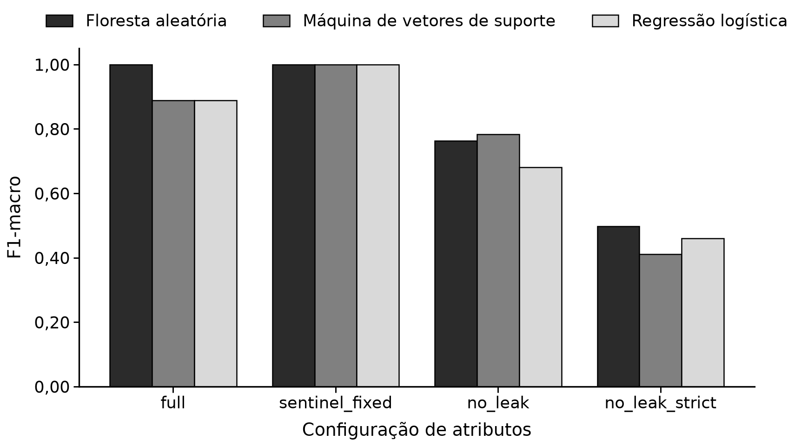
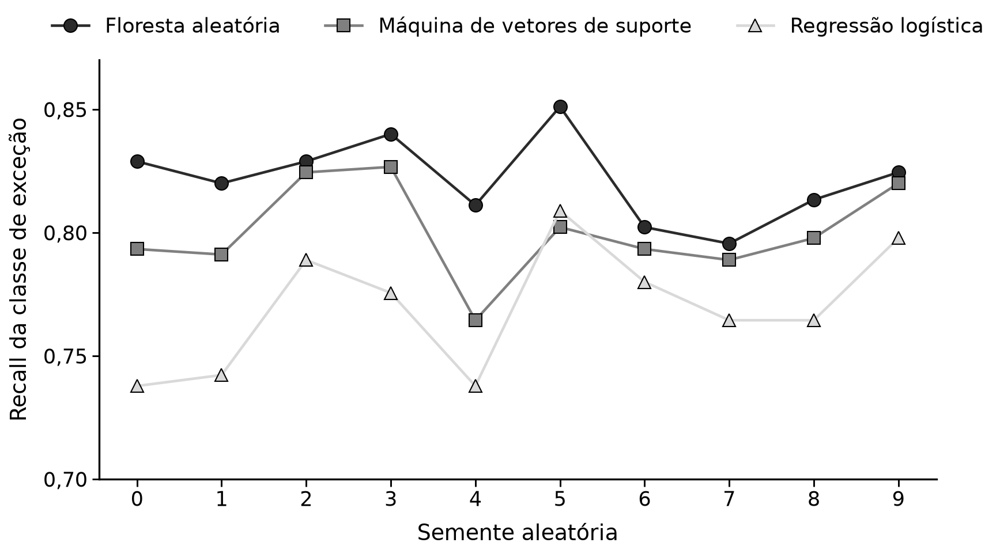

# Representação de dados determina o desempenho de algoritmos na conciliação contábil automatizada

> Versão em Markdown do Trabalho de Conclusão de Curso do MBA em Engenharia de Software (USP/ESALQ).
> O documento de referência é o original em
> [`TCC - Artur Rios da Silva Oliveira.docx`](TCC%20-%20Artur%20Rios%20da%20Silva%20Oliveira.docx)
> ([PDF](TCC%20-%20Artur%20Rios%20da%20Silva%20Oliveira.pdf)); em caso de divergência, prevalece o
> original. *English version:* [`monography.md`](monography.md). Termos técnicos estão definidos no
> [glossário](../glossary.md).

Artur Rios da Silva Oliveira<sup>1\*</sup>; Emerson Aparecido Mouco Júnior<sup>2</sup>

<sup>1\*</sup> Bacharel em Sistemas de Informação. UMC. E-mail autor correspondente: arturdev@duck.com

<sup>2</sup> Mestre em Administração. USP. E-mail: mouco@alumni.usp.br

## Resumo

A conciliação contábil consome tempo e permanece sujeita a erro humano nas organizações que a executam manualmente, o que motivou o interesse por automação apoiada em aprendizado supervisionado. Este trabalho investigou qual algoritmo melhor automatiza a conciliação entre registros de pagamento e notas fiscais de serviços eletrônicas, e em que medida esse desempenho decorre do algoritmo ou da representação atribuída aos dados. Foram simuladas duas fontes heterogêneas, uma planilha de pagamentos e um conjunto de documentos fiscais em formato XML, submetidas a extração, transformação e carga e empregadas no treinamento de floresta aleatória, máquina de vetores de suporte e regressão logística. O primeiro experimento produziu acurácia unitária para a floresta aleatória, desempenho que a auditoria do código atribuiu à circularidade entre a regra de rotulagem e os atributos preditores. Um experimento de ablação quantificou essa circularidade e demonstrou que a vantagem de onze pontos percentuais de F1-macro da floresta sobre os demais algoritmos decorria integralmente da codificação por valor-sentinela. Um segundo experimento, com rótulo derivado da verdade de origem do gerador, guarda automatizado contra vazamento e seleção por recall da classe de exceção sob precisão mínima de 0,90, reposicionou a comparação: em dez execuções, a floresta aleatória detectou 1,44 ponto percentual mais divergências que a máquina de vetores de suporte e 4,56 mais que a regressão logística, ao custo de encaminhar 27,6% do lote à revisão manual. A representação dos dados e a procedência do rótulo pesaram mais na conciliação contábil automatizada do que a escolha do algoritmo.

**Palavras-chave:** aprendizado supervisionado; vazamento de rótulo; floresta aleatória; controle interno; nota fiscal eletrônica.

## Abstract

**Data representation determines algorithm performance in automated accounting reconciliation**

Accounting reconciliation is time consuming and remains exposed to human error in organisations that still perform it manually, a condition that motivated interest in automation supported by supervised learning. This work investigated which algorithm best automates the reconciliation between payment records and electronic service invoices, and to what extent the observed performance follows from the algorithm or from the representation assigned to the data. Two heterogeneous sources were simulated, a supplier payment spreadsheet and a set of tax documents in XML format, processed through extraction, transformation and loading and used to train a random forest, a support vector machine and a logistic regression. The first experiment produced unit accuracy for the random forest, a performance that the code audit attributed to circularity between the labelling rule and the predictive attributes. An ablation experiment quantified that circularity and showed that the eleven percentage point macro-F1 advantage of the forest over the remaining algorithms followed entirely from sentinel value encoding. A second experiment, with the label taken from generator ground truth, an automated leakage guard and model selection by exception recall under a minimum precision of 0.90, repositioned the comparison: across ten independent runs the random forest detected 1.44 percentage points more divergences than the support vector machine and 4.56 percentage points more than the logistic regression, at the cost of referring 27.6% of the batch to manual review. Data representation and label provenance weighed more on automated accounting reconciliation than the choice of algorithm.

**Keywords:** supervised learning; label leakage; random forest; internal control; electronic invoice.

## Considerações Iniciais

A conciliação contábil consiste em conferir e compatibilizar dados de transações financeiras gerados por diferentes sistemas ou subsistemas, a partir de documentos-fonte padronizados, com a finalidade de identificar e corrigir erros, detectar fraudes e assegurar que os saldos finais reflitam a realidade econômica da organização (Mahmud e Fitriani, 2025). Em parcela expressiva das empresas a atividade permanece manual ou semiautomática, condição que eleva o tempo de execução, amplia a exposição ao erro humano e restringe a escalabilidade do controle à medida que cresce o volume de documentos processados.

Serviços de automação tornaram-se tendência em diversos setores, impulsionados pelos avanços recentes da inteligência artificial e do aprendizado de máquina (Soni et al., 2020). O aprendizado de máquina reúne algoritmos que exploram a correlação entre os dados de um conjunto, descobrem padrões e produzem modelos capazes de associar entradas a saídas e de generalizar esse comportamento para exemplos novos (França et al., 2021). Aplicado à conciliação, o paradigma supervisionado converte a decisão de conciliar em um problema de classificação sobre pares de registros, no qual o classificador recebe evidências observáveis do pareamento e devolve a categoria correspondente.

A heterogeneidade das fontes constitui obstáculo anterior à modelagem. Processos de extração, transformação e carga [ETL] coletam dados de múltiplas origens com esquemas distintos, transformam-nos em representação utilizável e realizam a limpeza necessária para assegurar a validade das informações empregadas no treinamento (Cormier et al., 2025). Chaves de conciliação como o número de inscrição do fornecedor, as datas de emissão e de pagamento e os valores nominais exigem normalização prévia para que a comparação entre fontes seja possível.

Formalmente, conciliar registros de pagamento contra documentos fiscais configura um problema de pareamento de registros, cuja fundamentação probabilística remonta ao modelo de Fellegi e Sunter (1969) e foi sistematizada por Christen (2012). Nesse arcabouço o objeto de decisão é o par candidato, e o esforço computacional concentra-se na geração de candidatos, uma vez que o espaço de pares cresce quadraticamente com o número de registros de cada fonte.

O emprego de aprendizado supervisionado nesse domínio enfrenta uma dificuldade específica. A maioria das organizações dispõe apenas de rótulos produzidos por suas próprias regras de negócio, e quando as grandezas que compõem a regra de rotulagem também integram o vetor de atributos, o alvo torna-se função determinística das entradas: o modelo recupera a regra em vez de aprender a tarefa. Kaufman et al. (2012) descreveram essa introdução, entre as variáveis preditoras, de informação derivada do próprio alvo, e identificaram como sintoma característico o desempenho implausivelmente alto e estável. A literatura de aprendizado de máquina aplicado à contabilidade e à auditoria registra distância recorrente entre a acurácia reportada e a utilidade operacional dos modelos (Appelbaum et al., 2017; Bao et al., 2020).

Neste trabalho os algoritmos foram empregados com finalidade supervisionada e classificatória, sobre dados simulados de pagamentos a fornecedores e de notas fiscais de serviços eletrônicas gerados segundo procedimentos estatísticos explícitos. Três classificadores de famílias distintas foram confrontados: a floresta aleatória, que particiona recursivamente o espaço de atributos (Breiman, 2001); a máquina de vetores de suporte, que busca a fronteira de margem máxima em espaço transformado por núcleo (Cortes e Vapnik, 1995); e a regressão logística, fronteira linear cujos coeficientes são diretamente interpretáveis. O método carrega limitação conhecida de antemão, que o próprio desenho procurou expor em vez de ocultar: rótulos derivados de regra interna restringem o que se pode aprender e o que se pode concluir a respeito dos algoritmos.

Este trabalho teve por objetivo determinar qual desses três algoritmos melhor automatiza a conciliação entre registros de pagamento e notas fiscais de serviços eletrônicas, e estabelecer em que medida o desempenho observado decorre do algoritmo escolhido ou da representação atribuída aos dados. A hipótese que orientou a pesquisa foi a de que a aplicação de algoritmos de aprendizado de máquina, em conjunto com um processo de extração, transformação e carga, não apenas automatizaria a conciliação, mas também aprimoraria sua qualidade, identificando inconsistências que escapariam às abordagens baseadas em regras.

## Implementação de Algoritmo(s) de Machine Learning

### Delineamento da pesquisa

A pesquisa caracterizou-se como estudo de natureza aplicada, com abordagem quantitativa, conduzido sob o delineamento de implementação de algoritmos de aprendizado de máquina. O desenvolvimento ocorreu em três etapas encadeadas, cada qual motivada pelo resultado da anterior. A primeira implementou o pipeline completo de conciliação, da simulação das fontes à avaliação dos modelos, em dois cenários de rigor de rótulo. A segunda submeteu a teste, por ablação controlada, duas hipóteses levantadas na auditoria dos resultados da primeira. A terceira reconstruiu o experimento sob rotulagem independente dos atributos, para responder à pergunta de pesquisa com poder discriminante.

Todo o código foi escrito em linguagem Python e organizado no pacote reconciliacao, com separação entre simulação, ETL, modelagem e avaliação. A totalidade dos parâmetros experimentais foi externalizada em um arquivo de configuração, sem valores fixos nos módulos de código, e a semente do gerador pseudoaleatório foi mantida constante, de modo que cada execução reproduz exatamente os mesmos artefatos. Os modelos e as métricas foram obtidos com a biblioteca scikit-learn (Pedregosa et al., 2011).

### Geração dos dados simulados

Na ausência de base contábil real com rótulos auditados, os dados foram gerados por simulação, procedimento admitido para trabalhos com temática de implementação de algoritmos desde que os critérios de geração sejam descritos em detalhe. O gerador produziu duas fontes heterogêneas e independentes em formato, replicando a situação em que a conciliação se apresenta na prática: uma planilha eletrônica com o registro de pagamentos a fornecedores e um conjunto de notas fiscais de serviços eletrônicas em formato XML, estruturadas segundo o padrão de intercâmbio adotado pelos municípios brasileiros.

Os números de inscrição dos fornecedores foram gerados com dígitos verificadores calculados, e não sorteados, de modo que a validação cadastral aplicada na etapa de limpeza tivesse referente real. Cada nota recebeu código de município segundo a tabela oficial de códigos, item da lista de serviços, valor dos serviços, alíquota e valor do imposto sobre serviços [ISS] calculado sobre esses dois campos. A descrição de cada pagamento e a discriminação de cada nota foram produzidas por chamadas independentes ao gerador de texto sintético. Os parâmetros da simulação constam da Tabela 1.

**Tabela 1.** Parâmetros da simulação do experimento principal

| Parâmetro | Valor |
| :--- | ---: |
| Registros de pagamento gerados | 7.500 |
| Taxa de conciliação | 70% |
| Semente do gerador pseudoaleatório | 42 |
| Divergência de data introduzida | 6 a 30 dias |
| Divergência de valor introduzida | 3% a 20% |
| Partição de teste, estratificada | 20% |
| Dobras da validação cruzada estratificada | 5 |

Fonte: Dados originais da pesquisa

A fração não conciliada da base, correspondente a 30% dos registros, distribuiu-se por três modos de divergência. O primeiro suprimiu a correspondência, seja por atribuição de inscrição inexistente ao pagamento, seja pela emissão de notas sem pagamento associado. O segundo deslocou a data de pagamento em intervalo sorteado entre seis e trinta dias. O terceiro alterou o valor pago por fator sorteado entre 3% e 20% do valor dos serviços.

### Extração, transformação e carga

O módulo de extração leu a planilha de pagamentos e percorreu os documentos XML, convertendo ambos em estruturas tabulares. O módulo de limpeza padronizou os números de inscrição pela remoção de máscara e pela validação dos dígitos verificadores, converteu datas para um tipo temporal único e normalizou os valores monetários. A junção entre as fontes foi realizada pela inscrição do fornecedor, e produziu 7.518 registros a partir dos 7.500 pagamentos solicitados. A diferença não decorreu de duplicidade resolvida no cruzamento: dezoito pagamentos tinham a inscrição repetida em duas notas, e a junção os multiplicou em duas linhas, doze delas com rótulos contraditórios entre si, por uma causa discutida adiante entre os modos de falha silenciosa.

O módulo de rotulagem atribuiu a classe de cada registro por regra determinística de limiar sobre duas grandezas calculadas na junção: a diferença absoluta em dias entre a data de pagamento e a data de emissão, e a diferença relativa entre o valor pago e o valor dos serviços. Dois cenários de rigor foram definidos, descritos na Tabela 2. No cenário exact a conciliação exigiu coincidência perfeita de data e de valor, com duas classes. No cenário fuzzy admitiram-se tolerâncias e acrescentou-se uma classe intermediária, atribuída aos registros situados dentro de quatro vezes a tolerância de data ou de cinco vezes a tolerância de valor. A Figura 1 reproduz o trecho do rotulador que implementa a regra.

**Tabela 2.** Cenários de rigor do rótulo

| Cenário | Tolerância de data | Tolerância de valor | Classes |
| :--- | ---: | ---: | ---: |
| exact | 0 dia | 0% | 2 |
| fuzzy | 5 dias | 2% | 3 |

Fonte: Dados originais da pesquisa

```python
# Divergência absoluta de data e de valor entre o pagamento e a nota
merged["delta_days"] = (merged["data_pagamento"]
                        - merged["nfse_data_emissao"]).dt.days.abs()
                        .fillna(9999)  # valor-sentinela
merged["delta_valor_pct"] = ((merged["valor_pago"]
                              - merged["nfse_valor_servicos"]).abs()
                             / safe_valor * 100).fillna(100.0)

# Regra determinística de limiar que define o rótulo
mask_date_ok = merged["delta_days"] <= date_tolerance_days
mask_valor_ok = merged["delta_valor_pct"] <= value_tolerance_pct
if n_classes == 2:  # cenário exact
    merged.loc[mask_date_ok & mask_valor_ok, "label"] = 1
else:  # cenário fuzzy
    mask_date_close = merged["delta_days"] <= date_tolerance_days * 4
    mask_valor_close = merged["delta_valor_pct"] <= value_tolerance_pct * 5
    mask_parcial = (~(mask_date_ok & mask_valor_ok)) & (mask_date_close
                                                        | mask_valor_close)
    merged.loc[mask_parcial, "label"] = 1
    merged.loc[mask_date_ok & mask_valor_ok, "label"] = 2
```

**Figura 1.** Regra de rotulagem do experimento principal, aplicada sobre a diferença de data e a diferença relativa de valor

Fonte: Dados originais da pesquisa

### Engenharia de atributos e algoritmos avaliados

A matriz de atributos do experimento principal reuniu sete variáveis, descritas na Tabela 3. Registros de pagamento sem nota correspondente não possuem diferença de data nem de valor calculável, e receberam valores-sentinela: 9.999 para a diferença de dias e 100 para a diferença percentual de valor. Essa decisão de codificação, aparentemente inócua, revelou-se determinante para o resultado, conforme discutido adiante.

**Tabela 3.** Atributos do experimento principal

| Atributo | Derivação |
| :--- | :--- |
| delta_days | módulo da diferença, em dias, entre a data de pagamento e a data de emissão |
| delta_valor_pct | módulo da diferença relativa entre o valor pago e o valor dos serviços |
| valor_pago | valor nominal registrado no pagamento |
| nfse_valor_iss | valor do ISS declarado na nota |
| nfse_aliquota | alíquota do ISS declarada na nota |
| descricao_similarity | cosseno entre as representações TF-IDF da descrição do pagamento e da discriminação da nota |
| cnpj_match | indicador de presença da inscrição do fornecedor no registro de pagamento |

Fonte: Dados originais da pesquisa

Os três algoritmos foram encapsulados em fluxos de processamento que incluíam, quando necessário, a padronização por escore z, e foram ajustados por busca exaustiva em grade com validação cruzada estratificada de cinco dobras, maximizando o F1-macro. A Tabela 4 detalha o pré-processamento e o espaço de busca de cada algoritmo, e a Figura 2 reproduz a definição dos fluxos. A partição de teste correspondeu a 20% dos registros, estratificada pela classe e isolada antes de qualquer ajuste.

**Tabela 4.** Algoritmos, pré-processamento e grades de hiperparâmetros

| Algoritmo | Pré-processamento | Hiperparâmetros pesquisados |
| :--- | :--- | :--- |
| Floresta aleatória | nenhum | número de árvores (100; 200); profundidade máxima (sem limite; 10) |
| Máquina de vetores de suporte | padronização por escore z; calibração de probabilidades | custo C (0,1; 1,0; 10,0) |
| Regressão logística | padronização por escore z | inverso da regularização C (0,01; 0,1; 1,0; 10,0) |

Fonte: Dados originais da pesquisa

Nota: os três algoritmos foram ajustados com ponderação de classes inversamente proporcional à frequência

```python
"random_forest": (
    Pipeline([("clf", RandomForestClassifier(
        n_estimators=mcfg["random_forest"]["n_estimators"],
        class_weight=mcfg["random_forest"]["class_weight"],
        random_state=seed))]),
    {"clf__n_estimators": [100, 200], "clf__max_depth": [None, 10]}),
"svm": (
    Pipeline([("scaler", StandardScaler()),
              ("clf", CalibratedClassifierCV(
                  SVC(kernel=mcfg["svm"]["kernel"],
                      class_weight=mcfg["svm"]["class_weight"],
                      random_state=seed), ensemble=False))]),
    {"clf__estimator__C": [0.1, 1.0, 10.0]}),
"logistic_regression": (
    Pipeline([("scaler", StandardScaler()),
              ("clf", LogisticRegression(
                  class_weight=mcfg["logistic_regression"]["class_weight"],
                  max_iter=1000, random_state=seed))]),
    {"clf__C": [0.01, 0.1, 1.0, 10.0]}),
```

**Figura 2.** Definição dos três fluxos de processamento e das respectivas grades de hiperparâmetros, reutilizada sem alteração nos três experimentos

Fonte: Dados originais da pesquisa

### Experimento de ablação

A auditoria dos resultados do experimento principal levantou duas hipóteses explicativas, formuladas na seção seguinte, que exigiam verificação empírica. Para submetê-las a teste foi conduzido um experimento de ablação que manteve constantes os dados, a divisão entre treino e teste, a semente, a grade de hiperparâmetros e o protocolo de validação cruzada, variando exclusivamente a representação dos atributos. Os artefatos do experimento original foram preservados; a ablação escreveu em diretório próprio. As quatro configurações avaliadas constam da Tabela 5.

**Tabela 5.** Configurações do experimento de ablação

| Configuração | Atributos | Hipótese submetida a teste |
| :--- | :--- | :--- |
| full | os sete originais | linha de base, que replica o experimento principal |
| sentinel_fixed | os sete originais, acrescidos de indicador de correspondência, com imputação neutra no lugar das sentinelas | a diferença entre os algoritmos é artefato da escala |
| no_leak | sem delta_days e sem delta_valor_pct | parcela do desempenho atribuível ao vazamento direto |
| no_leak_strict | também sem nfse_valor_iss e sem nfse_aliquota | parcela atribuível ao vazamento indireto pelos campos de ISS |

Fonte: Dados originais da pesquisa

Nota: na configuração sentinel_fixed os registros sem correspondência receberam indicador nulo e imputação das diferenças pela mediana dos registros pareados

### Experimento de comparação com rotulagem independente

O experimento de comparação foi construído sobre um princípio único: o rótulo vem do gerador e nenhum atributo participa de sua definição. O desacoplamento foi obtido por construção, e não por remoção de variáveis. O gerador conhece qual pagamento quita qual nota, persiste essa correspondência em uma tabela de verdade e a mantém inacessível à engenharia de atributos, que reconstrói apenas o que um analista de conciliação observaria.

O segundo desvio em relação ao desenho original diz respeito à natureza dos pares legítimos. No experimento principal, um par verdadeiro era uma cópia: mesma data e mesmo valor. No experimento de comparação, o pagamento foi derivado da nota por transformação legítima. A data de pagamento resultou da soma da data de emissão a um prazo sorteado uma única vez por fornecedor, de modo que cada fornecedor passasse a ter prazo característico estimável a partir do histórico, com fração declarada de exceções legítimas. O valor pago resultou da aplicação de retenções tributárias sobre o valor dos serviços, sorteadas entre as combinações apresentadas na Tabela 6, que envolvem o imposto de renda retido na fonte [IRRF], as contribuições sociais retidas na fonte [CSRF], a contribuição previdenciária [INSS] e o ISS retido pelo tomador.

**Tabela 6.** Combinações de retenção admitidas na geração dos pares verdadeiros

| Combinação | Retenção total | Condição de incidência |
| :--- | :--- | :--- |
| Nenhuma | 0,00% | — |
| IRRF | 1,50% | — |
| CSRF | 4,65% | valor dos serviços acima de R$ 5.000,00 |
| IRRF e CSRF | 6,15% | valor dos serviços acima de R$ 5.000,00 |
| ISS retido | alíquota declarada, de 2,00% a 5,00% | — |
| IRRF e ISS retido | 1,50% mais a alíquota declarada | — |
| IRRF, CSRF e ISS retido | 6,15% mais a alíquota declarada | valor dos serviços acima de R$ 5.000,00 |
| INSS | 11,00% | — |

Fonte: Dados originais da pesquisa

Nota: as alíquotas e o limite de incidência são parâmetros de configuração do gerador e não constituem afirmação normativa; as alíquotas de 1,50%, 4,65% e 11,00% correspondem às retenções vigentes de IRRF sobre serviços profissionais, de CSRF e de contribuição previdenciária, ao passo que o limite de R$ 5.000,00 reproduz a redação do art. 31 da Lei nº 10.833/2003 anterior à Lei nº 13.137/2015, que o revogou — ele foi mantido por criar a interação condicional que o experimento explora, e não por descrever a regra em vigor

A consequência dessa transformação é que uma razão de valor de 0,9535 deixou de significar divergência e passou a significar compatibilidade com a retenção das contribuições sociais. Como essa retenção incide apenas acima do limite configurado, surgiu uma interação condicional genuína entre o valor dos serviços e a diferença legítima esperada, isto é, uma fronteira não linear sobre combinações discretas de alíquotas condicionada a um limiar em outra variável. É precisamente o tipo de estrutura em que o particionamento axial, a fronteira de margem com núcleo radial e a fronteira linear possuem capacidades distintas.

Os não-pares foram construídos para não serem trivialmente separáveis. Ao menos 30% deles receberam razão de valor cuja retenção implícita cai dentro da tolerância de alguma combinação legítima, de sorte que não são resolvíveis pelo valor e exigem outra evidência. Simetricamente, uma fração dos pares verdadeiros foge do prazo típico do fornecedor, apresenta divergência de centavos por arredondamento no ISS declarado ou traz descrição não relacionada, e os não-pares corrompem um subconjunto sorteado das dimensões de evidência, e não uma dimensão fixa. Sem essa sobreposição deliberada, qualquer dimensão isolada se converteria em nova regra determinística e o problema original seria reproduzido. A descrição do pagamento passou a ser derivada da discriminação da nota por abreviação de palavras, transposição de caracteres adjacentes e perda de acentuação, o que conferiu à similaridade textual conteúdo informativo genuíno, ainda que imperfeito.

A matriz de evidências passou a reunir catorze atributos, descritos na Tabela 7, todos computáveis por quem desconhece a genuinidade do pareamento. Os indicadores de compatibilidade codificam conhecimento de domínio a partir de campos observáveis, e um não-par pode ser coincidentemente compatível, que é exatamente o que caracteriza um caso difícil. A mediana de prazo por fornecedor foi estimada apenas na partição de treino e aplicada às demais, com recurso à mediana global do treino para fornecedores ausentes, para evitar o vazamento transdutivo de estatística agregada.

**Tabela 7.** Atributos do experimento de comparação

| Atributo | Derivação |
| :--- | :--- |
| delta_dias | diferença, com sinal, em dias, entre a data de pagamento e a data de emissão |
| razao_valor | quociente entre o valor pago e o valor dos serviços |
| retencao_implicita_pct | complemento percentual da razão de valor |
| valor_retido_brl | diferença, em reais, entre o valor dos serviços e o valor pago |
| compat_irrf | proximidade da retenção implícita à alíquota de IRRF |
| compat_csrf | proximidade da retenção implícita à alíquota de CSRF |
| compat_irrf_csrf | proximidade da retenção implícita à soma de IRRF e CSRF |
| compat_iss | proximidade da retenção implícita à alíquota de ISS declarada |
| compat_combo_iss | proximidade às combinações que incluem o ISS retido |
| compat_inss | proximidade da retenção implícita à alíquota de INSS |
| acima_limite_csrf | indicador de valor dos serviços acima do limite de incidência da CSRF |
| desvio_prazo_fornecedor | diferença entre o prazo observado e a mediana histórica do fornecedor, estimada na partição de treino |
| similaridade_descricao | cosseno entre as representações TF-IDF da descrição do pagamento e da discriminação da nota |
| mesmo_municipio | indicador de coincidência entre o município do centro de custo do pagamento e o município declarado na nota |

Fonte: Dados originais da pesquisa

Nota: os indicadores de compatibilidade utilizam tolerância de 0,05 ponto percentual sobre a retenção implícita

### Guarda contra vazamento de rótulo

O requisito de que nenhuma dimensão de evidência separe as classes sozinha foi convertido em verificação executável. Antes de cada treinamento, o guarda ajustou uma árvore de decisão de profundidade um sobre cada atributo isoladamente, mediu a acurácia por validação cruzada e interrompeu o pipeline com erro, e não com aviso, sempre que algum atributo ultrapassasse o teto configurado de 0,95. O guarda operacionalizou como teste de regressão a recomendação derivada do experimento principal, e sua implementação consta da Figura 3.

```python
def stump_accuracies(X, y, cv=3, seed=42):
    """Acurácia, em validação cruzada, de uma árvore de profundidade um
    ajustada sobre cada atributo isoladamente."""
    folds = StratifiedKFold(n_splits=cv, shuffle=True, random_state=seed)
    scores = {}
    for column in X.columns:
        stump = DecisionTreeClassifier(max_depth=1, random_state=seed)
        scores[column] = float(cross_val_score(
            stump, X[[column]], y, cv=folds, scoring="accuracy").mean())
    return pd.Series(scores).sort_values(ascending=False)

def assert_no_leak(X, y, max_accuracy, cv=3, seed=42):
    """Falha o pipeline quando algum atributo isolado prediz bem demais."""
    report = stump_accuracies(X, y, cv=cv, seed=seed)
    offenders = report[report > max_accuracy]
    if not offenders.empty:
        raise LeakDetected(
            f"acurácia de atributo isolado acima de {max_accuracy}: "
            f"{dict(offenders)}. O rótulo é recuperável de um atributo.")
    return report
```

**Figura 3.** Guarda contra vazamento de rótulo, executado antes de cada treinamento do experimento de comparação

Fonte: Dados originais da pesquisa

### Critério de decisão e comparação estatística

A seleção de modelo deixou de recair sobre métricas simétricas e passou a derivar do objetivo de controle. Em conciliação, deixar passar uma divergência e encaminhar um pagamento legítimo à revisão manual não possuem o mesmo custo: o primeiro silencia uma exceção e compromete o controle interno, ao passo que o segundo apenas gera trabalho redundante. A métrica primária adotada foi, portanto, o recall da classe de exceção sob a restrição de precisão mínima de 0,90 nessa mesma classe. O limiar de decisão que satisfazia a restrição foi escolhido na partição de validação e aplicado sem reajuste à partição de teste, conforme a Figura 4, e a taxa de encaminhamento à revisão manual foi reportada ao lado da métrica primária, por constituir o custo operacional que acompanha o ganho de detecção. A área sob a curva de precisão e recall, o F1-macro e a matriz de confusão completa foram registrados como métricas secundárias.

```python
def choose_threshold(y_val, proba_excecao, min_precision):
    """Maior recall de exceção cuja precisão atinge o piso exigido.
    Devolve None quando nenhum limiar alcança o piso: nesse caso o
    algoritmo é reportado como incapaz de satisfazer a restrição."""
    is_exception = (np.asarray(y_val) == 0).astype(int)
    precision, recall, thresholds = precision_recall_curve(
        is_exception, proba_excecao)
    best_threshold, best_recall = None, -1.0
    for p, r, t in zip(precision[:-1], recall[:-1], thresholds):
        if p >= min_precision and r > best_recall:
            best_threshold, best_recall = float(t), float(r)
    return best_threshold
```

**Figura 4.** Escolha do limiar de decisão na partição de validação, sob piso de precisão da classe de exceção

Fonte: Dados originais da pesquisa

O ajuste de hiperparâmetros exigiu correção correlata. O critério padrão de precisão média da biblioteca utilizada avalia a classe positiva, que nesse desenho é o par legítimo, ao passo que todo o critério de decisão recai sobre a classe de exceção. A função de pontuação foi redefinida para a classe de exceção, de modo que a seleção de hiperparâmetros, a escolha do limiar e a métrica reportada apontassem para o mesmo lado da decisão.

A partição por semente foi de 60% para treino, 20% para validação e 20% para teste, estratificada. Dez sementes independentes geraram dez bases completas, produzindo dez valores pareados por algoritmo e por métrica. A comparação entre algoritmos foi realizada pelo teste de postos sinalizados de Wilcoxon (Wilcoxon, 1945) aplicado aos pares, com correção de Holm (Holm, 1979) para as três comparações múltiplas, conforme a Figura 5. O tamanho de efeito, expresso como diferença mediana em pontos percentuais, foi reportado ao lado do valor-p, uma vez que significância estatística desacompanhada de magnitude não sustenta recomendação prática (Demšar, 2006).

```python
def paired_comparisons(per_seed, metric):
    """Wilcoxon pareado entre os três algoritmos, com correção de Holm."""
    wide = per_seed.pivot(index="seed", columns="algorithm", values=metric)
    algorithms = sorted(wide.columns)
    rows, raw_p_values = [], []
    for a, b in combinations(algorithms, 2):
        diff = wide[a] - wide[b]
        result = wilcoxon(wide[a], wide[b], zero_method="wilcox")
        raw_p_values.append(float(result.pvalue))
        rows.append({"algorithm_a": a, "algorithm_b": b,
                     "median_diff": float(diff.median()),
                     "p_value": float(result.pvalue)})
    for row, p_holm in zip(rows, _holm(raw_p_values)):
        row["p_holm"] = p_holm
        row["significant"] = p_holm < ALPHA
    return pd.DataFrame(rows)
```

**Figura 5.** Comparação pareada entre algoritmos ao longo das dez sementes, com correção de Holm e tamanho de efeito

Fonte: Dados originais da pesquisa

### Reprodutibilidade e verificação automatizada

A reprodutibilidade foi tratada como requisito de projeto, e não como consequência. Todos os parâmetros de simulação, rotulagem, modelagem e avaliação residem em um único arquivo de configuração; a semente é explícita em cada camada; e os artefatos de cada cenário são persistidos em diretórios separados. A janela de datas simuladas foi ancorada em uma data de referência declarada na configuração, e não no relógio, e a lista de inscrições passou a ser construída na ordem de sorteio, e não pela iteração de um conjunto — duas correções cuja ausência tornava o experimento principal não reprodutível, como a discussão detalha. Uma suíte de 140 testes automatizados cobre os quatro módulos do pacote e inclui asserções de regressão para os modos de falha descobertos ao longo do trabalho, entre eles a detecção de vazamento em base deliberadamente circular, a exigência de que nenhuma coluna seja constante na partição de treino, a exigência de que treino e teste apresentem escalas comparáveis, a reprodutibilidade da geração entre processos distintos e a verificação de que o limiar de decisão jamais seja calibrado no conjunto de teste.

## Resultados e Discussão

### Desempenho no experimento principal

Os três algoritmos foram treinados e avaliados nos dois cenários de rigor de rótulo, sobre a partição de teste de 1.504 registros. As Tabelas 8 e 9 reúnem o desempenho obtido. A floresta aleatória atingiu valor unitário em todas as métricas, nos dois cenários, com desvio-padrão de validação cruzada exatamente nulo no cenário exact. A máquina de vetores de suporte e a regressão logística estacionaram em 0,8892 de F1-macro no cenário exact, diferença de onze pontos percentuais de F1-macro em relação à floresta.

**Tabela 8.** Desempenho dos algoritmos no cenário exact

| Métrica | Floresta aleatória | Máquina de vetores de suporte | Regressão logística |
| :--- | ---: | ---: | ---: |
| Acurácia | 1,0000 | 0,9149 | 0,9149 |
| F1-macro | 1,0000 | 0,8892 | 0,8892 |
| Precisão-macro | 1,0000 | 0,9457 | 0,9457 |
| Recall-macro | 1,0000 | 0,8590 | 0,8590 |
| Validação cruzada | 1,0000 ± 0,0000 | 0,9061 ± 0,0072 | 0,9081 ± 0,0089 |
| ROC-AUC | 1,0000 | 0,9824 | 0,9877 |

Fonte: Resultados originais da pesquisa

Nota: a linha de validação cruzada apresenta média e desvio-padrão do F1-macro em cinco dobras do conjunto de treino

**Tabela 9.** Desempenho dos algoritmos no cenário fuzzy

| Métrica | Floresta aleatória | Máquina de vetores de suporte | Regressão logística |
| :--- | ---: | ---: | ---: |
| Acurácia | 1,0000 | 0,9182 | 0,9282 |
| F1-macro | 1,0000 | 0,8672 | 0,8791 |
| Precisão-macro | 1,0000 | 0,9264 | 0,9664 |
| Recall-macro | 1,0000 | 0,8371 | 0,8407 |
| Validação cruzada | 0,9978 ± 0,0021 | 0,8611 ± 0,0137 | 0,8674 ± 0,0155 |

Fonte: Resultados originais da pesquisa

Nota: a área sob a curva ROC não se aplica a este cenário, de três classes

### Circularidade entre a regra de rotulagem e os atributos

O achado mais relevante deste trabalho não é que a floresta aleatória superou os demais classificadores, e sim a razão pela qual alcançou valor unitário com dispersão nula. A inspeção do pipeline expõe circularidade entre rotulagem e representação: o módulo de rotulagem define o rótulo como conjunção de dois limiares sobre a diferença de data e a diferença relativa de valor, e o módulo de engenharia de atributos entrega essas mesmas duas grandezas ao classificador. O alvo é, portanto, função exata e inteiramente conhecida de duas das sete variáveis de entrada. O problema submetido aos algoritmos não foi aprender a conciliar, mas recuperar uma conjunção de dois limiares alinhados aos eixos a partir de exemplos, tarefa para a qual o particionamento recursivo de árvores é a hipótese indutiva perfeitamente adequada.

A evidência empírica é inequívoca. No cenário exact, a diferença relativa de valor e a diferença de dias concentraram, respectivamente, cerca de 0,44 e 0,43 da importância total por redução de impureza, o que corresponde a aproximadamente 87% do total; as cinco variáveis restantes somaram cerca de 13%, e o indicador de inscrição do fornecedor apresentou importância exatamente nula. A medida é enviesada em favor de variáveis contínuas de alta cardinalidade (Strobl et al., 2007), mas a hierarquia observada mostrou-se robusta o bastante para sustentar o argumento.

O padrão corresponde ao vazamento descrito por Kaufman et al. (2012), cujo sintoma clássico é justamente o desempenho implausivelmente alto e estável. A acurácia unitária com desvio-padrão de validação cruzada nulo constitui, assim, diagnóstico e não resultado. A advertência é diretamente transferível às equipes que pretendam aplicar aprendizado supervisionado à conciliação a partir de rótulos gerados por regras internas, situação extremamente comum na prática, já que poucas organizações dispõem de rótulos auditados de forma independente.

### O artefato de escala na codificação por sentinela

O contraste entre a floresta aleatória e os modelos de fronteira suave não decorreu de superioridade conceitual das florestas para o domínio de conciliação, mas de uma interação entre a codificação de ausência de correspondência e a padronização de escala. Os 1.119 registros sem nota correspondente, 14,9% da base, receberam os valores-sentinela descritos na metodologia. A floresta aleatória é invariante a transformações monotônicas, pois apenas a ordem importa para a escolha de pontos de corte. Os dois modelos restantes operam sobre variáveis padronizadas, e a sentinela distorce severamente a média e o desvio-padrão, conforme a Tabela 10.

**Tabela 10.** Efeito da padronização sobre a diferença de dias no cenário exact

| Valor original | Escore padronizado |
| :--- | ---: |
| 0 dia | −0,4188 |
| 5 dias | −0,4174 |
| 6 dias | −0,4171 |
| 30 dias | −0,4103 |
| 9.999 dias, valor-sentinela | 2,3913 |

Fonte: Resultados originais da pesquisa

Nota: a variável apresenta média de 1.490,05 e desvio-padrão de 3.558,25 na base do cenário exact

Toda a faixa informativa da diferença de dias, de zero a trinta dias, que é onde reside a decisão de conciliação, comprimiu-se em um intervalo de 0,0084 desvio-padrão, ao passo que a sentinela ocupou sozinha 2,8 desvios. Para um classificador de margem, a distância entre um pagamento na data exata e um pagamento com trinta dias de defasagem tornou-se numericamente indistinguível de ruído. A diferença relativa de valor sofreu distorção muito menor, com 0,167 desvio-padrão separando a coincidência perfeita de uma divergência de 6%, o que explica com precisão o padrão de erros: os modelos suaves continuaram separando divergências de valor e perderam quase completamente a capacidade de separar divergências de data. A decomposição dos erros confirma isso de forma exata. O conjunto de teste contém 454 negativos, sendo 208 sem nota alguma, 115 com divergência de valor e 131 com divergência de data; dos 128 falsos positivos cometidos pelos dois modelos, todos os 128 são divergências de data. Os dois detectam 208 de 208 ausências de nota e 115 de 115 divergências de valor, e deixam passar 128 das 131 divergências de data. A dimensão que a sentinela esmagou é exatamente, e somente, a que os modelos perderam.

Indício adicional dessa degeneração é que a máquina de vetores de suporte e a regressão logística produziram matrizes de confusão rigorosamente idênticas no cenário exact. Dois modelos de famílias distintas convergindo para a mesma partição do espaço de teste sugerem que ambos colapsaram para essencialmente a mesma decisão univariada sobre a diferença relativa de valor.

### Resultados do experimento de ablação

As duas hipóteses foram submetidas a teste no experimento de ablação, cujos resultados em F1-macro constam da Tabela 11 e da Figura 6. A configuração de linha de base reproduziu os valores do experimento principal com precisão de quatro casas decimais, apesar de executada sob versões mais recentes das bibliotecas, o que constitui verificação independente da reprodutibilidade do pipeline.

**Tabela 11.** F1-macro por configuração de atributos, cenário e algoritmo

| Configuração | Cenário | Floresta aleatória | Máquina de vetores de suporte | Regressão logística |
| :--- | :--- | ---: | ---: | ---: |
| full | exact | 1,0000 | 0,8892 | 0,8892 |
| sentinel_fixed | exact | 1,0000 | 1,0000 | 1,0000 |
| no_leak | exact | 0,7630 | 0,7837 | 0,6815 |
| no_leak_strict | exact | 0,4976 | 0,4111 | 0,4608 |
| full | fuzzy | 1,0000 | 0,8672 | 0,8791 |
| sentinel_fixed | fuzzy | 1,0000 | 1,0000 | 1,0000 |
| no_leak | fuzzy | 0,6526 | 0,6334 | 0,6540 |
| no_leak_strict | fuzzy | 0,3313 | 0,2741 | 0,2618 |

Fonte: Resultados originais da pesquisa



**Figura 6.** F1-macro por configuração de atributos e algoritmo no cenário exact

Fonte: Resultados originais da pesquisa

Nota: a configuração full replica o experimento principal; sentinel_fixed substitui os valores-sentinela por indicador explícito de correspondência

Na configuração que substituiu a sentinela por indicador explícito de correspondência, os três algoritmos atingiram matrizes de confusão idênticas e perfeitas no cenário exact, com 454 verdadeiros negativos, 1.050 verdadeiros positivos e nenhum erro em qualquer direção. A diferença de onze pontos percentuais de F1-macro entre a floresta aleatória e os modelos de fronteira suave desapareceu por completo mediante uma única alteração de pré-processamento, sem qualquer mudança de algoritmo, de hiperparâmetro ou de dados. A explicação é geometricamente transparente: removida a sentinela, os registros conciliados ocupam exatamente a origem do plano formado pelas duas diferenças, e a classe torna-se linearmente separável com o auxílio do indicador. O que impedia a regressão logística de encontrar essa fronteira não era sua natureza linear, e sim o esmagamento de escala provocado pelo valor-sentinela.

A primeira pergunta de pesquisa precisa, portanto, ser reformulada. Sob representação adequada os três algoritmos são equivalentes neste desenho, e a questão relevante deixa de ser qual algoritmo escolher e passa a ser como representar os dados. O resultado está alinhado à literatura clássica de comparação empírica de classificadores: o teorema da inexistência de almoço grátis (Wolpert, 1996) e o levantamento de Fernández-Delgado et al. (2014) sobre 121 conjuntos de dados sustentam que o desempenho relativo de algoritmos é condicionado à representação, e não intrínseco à família do modelo.

A remoção das variáveis da regra confirmou a hipótese de circularidade e produziu um resultado adicional digno de nota: a ordem entre os algoritmos inverteu-se no cenário exact, com a máquina de vetores de suporte superando a floresta aleatória. A conclusão de que a floresta seria o melhor algoritmo para conciliação não sobreviveu à remoção do vazamento. Mais importante que a magnitude da queda é a natureza do que restou detectável, decomposta na Tabela 12.

**Tabela 12.** Decomposição dos acertos na classe negativa sem as variáveis da regra, cenário exact

| Algoritmo | Registros sem correspondência detectados | Divergências de data ou valor detectadas |
| :--- | ---: | ---: |
| Floresta aleatória | 208 de 208 (100,0%) | 1 de 246 (0,4%) |
| Máquina de vetores de suporte | 208 de 208 (100,0%) | 22 de 246 (8,9%) |
| Regressão logística | 208 de 208 (100,0%) | 65 de 246 (26,4%) |

Fonte: Resultados originais da pesquisa

Sem as variáveis da regra, os modelos identificaram com perfeição os pagamentos sem nota fiscal alguma e permaneceram praticamente cegos às divergências de data e de valor. Detectar a ausência de correspondência, porém, não é aprendizado de máquina: é o resultado de uma junção relacional, obtenível por consulta de uma linha em linguagem estruturada. O sinal aparentemente residual é, ele próprio, vazamento indireto, pois o valor e a alíquota do ISS valem zero exatamente quando não existe nota. A configuração que removeu também esses campos confirmou o argumento: o desempenho colapsou para a faixa de 0,41 a 0,50 de F1-macro no cenário exact e de 0,25 a 0,35 no cenário fuzzy, e a máquina de vetores de suporte degenerou para o classificador trivial, predizendo a classe majoritária em todos os casos e obtendo acurácia de 0,6981, exatamente a proporção de registros conciliados na base.

Descontado o vazamento direto e o indireto, o conjunto de dados sintéticos do experimento principal não contém sinal aprendível para a tarefa de conciliação. Esse resultado não invalida o trabalho: delimita com precisão o que ele demonstra e converte o que seria uma fragilidade oculta em achado metodológico explícito e mensurado.

### Assimetria dos erros e custo em controle interno

O achado de maior relevância prática reside na estrutura dos erros, e não em sua quantidade. A Tabela 13 apresenta a distribuição dos erros no conjunto de teste do cenário exact.

**Tabela 13.** Distribuição dos erros no conjunto de teste do cenário exact

| Algoritmo | Verdadeiros negativos | Falsos positivos | Falsos negativos | Verdadeiros positivos |
| :--- | ---: | ---: | ---: | ---: |
| Floresta aleatória | 454 | 0 | 0 | 1.050 |
| Máquina de vetores de suporte | 326 | 128 | 0 | 1.050 |
| Regressão logística | 326 | 128 | 0 | 1.050 |

Fonte: Resultados originais da pesquisa

Em conciliação financeira, as duas categorias de erro têm consequências assimétricas. Um falso negativo, isto é, um pagamento legítimo classificado como não conciliado, gera trabalho manual desnecessário: há custo operacional, mas o controle permanece íntegro. Um falso positivo silencia a divergência: um pagamento com valor 3% superior ao da nota, ou emitido trinta dias fora da competência, recebe aprovação automática e jamais chega à revisão humana. Os modelos de fronteira suave cometeram 128 falsos positivos e nenhum falso negativo, ou seja, erraram sistematicamente na direção mais custosa para o controle interno. No cenário fuzzy o efeito é ainda mais pronunciado, pois 107 dos 226 registros parcialmente conciliados do conjunto de teste, ou 47,3%, receberam atestado de conformidade plena. A ablação mostra que o viés se agrava quando o vazamento é removido: sem as variáveis da regra, a floresta aleatória passou a cometer 245 falsos positivos contra nenhum falso negativo.

A tendência a silenciar exceções não é acidental. Decorre da combinação entre o desbalanço de classes, com 69,8% de registros conciliados, e uma métrica de seleção simétrica que trata como equivalentes a revisão manual redundante e a divergência não detectada. O ponto conecta o trabalho à teoria de aprendizado sensível a custo (Elkan, 2001) e sustenta a recomendação de que, em conciliação, a métrica de seleção de modelo seja o recall da classe de exceção sob restrição de precisão mínima aceitável, e não a acurácia nem o F1-macro. A ordenação não é uma preferência deste trabalho: a norma brasileira de amostragem em auditoria define o risco de amostragem como a possibilidade de duas conclusões erradas e as hierarquiza explicitamente, atribuindo à conclusão de que não há distorção relevante quando ela existe o comprometimento da eficácia da auditoria, e à conclusão oposta apenas o da eficiência, por gerar trabalho adicional (Conselho Federal de Contabilidade [CFC], 2009). A divergência silenciada é o erro de eficácia; a revisão redundante, o de eficiência. Um sistema que encaminha 15% dos registros à revisão manual sem deixar passar divergência alguma é operacionalmente superior a outro que automatiza 91% silenciando parcela expressiva das exceções.

A área sob a curva ROC e o F1-macro divergiram: a máquina de vetores de suporte atingiu 0,9824 de área no cenário exact com apenas 0,8892 de F1-macro, e a regressão logística 0,9877 com o mesmo 0,8892. Com classes desbalanceadas, a curva ROC produz impressão otimista do desempenho, fenômeno documentado por Saito e Rehmsmeier (2015). A ablação oferece ilustração ainda mais didática, pois no cenário fuzzy sem vazamento a máquina de vetores de suporte alcançou acurácia de 0,8491 sem jamais predizer a classe intermediária, com recall nulo nessa classe.

### O efeito do rigor do rótulo

A segunda pergunta de pesquisa, relativa ao efeito do rigor do rótulo sobre o ordenamento dos algoritmos, exige resposta mais cuidadosa do que a tabela de métricas sugere. O gerador produz divergências de data por deslocamento sorteado entre seis e trinta dias, e divergências de valor por fator sorteado entre 3% e 20%. As tolerâncias do cenário fuzzy são de cinco dias e 2%. Por construção, portanto, nenhum registro cai dentro da janela de tolerância, o que a verificação empírica confirma: na base fuzzy, todos os 5.250 registros da classe plenamente conciliada apresentam diferença de data e diferença de valor exatamente nulas, com máximos e mínimos coincidentes.

O cenário fuzzy não avaliou, assim, robustez a tolerâncias. O que efetivamente fez foi subdividir a classe negativa em duas, aplicando uma regra de proximidade sobre as mesmas variáveis vazadas. A conclusão legítima é mais restrita e mais interessante: o aumento da granularidade do rótulo, de binário para ternário, degradou o desempenho dos modelos de fronteira suave, com queda do F1-macro de 0,8892 para 0,8672 na máquina de vetores de suporte, sem afetar a floresta aleatória, porque a classe intermediária é definida por limiares sobre as mesmas grandezas. A dificuldade adicional recai integralmente sobre a fronteira entre a classe parcial e a classe conciliada, que é justamente a região comprimida pela padronização.

### Comparação entre algoritmos sob rotulagem independente

As seções anteriores estabeleceram que a comparação original não possuía poder discriminante. O experimento corretivo, com rótulo derivado da verdade de origem, responde à primeira pergunta de pesquisa. Antes de qualquer treinamento, o guarda contra vazamento avaliou cada atributo isoladamente nas dez execuções. A maior acurácia de atributo isolado foi de 0,8173, bastante abaixo do teto de 0,95, e os seis atributos mais informativos constam da Tabela 14.

**Tabela 14.** Acurácia de árvore de profundidade um por atributo, média das dez execuções

| Atributo | Acurácia |
| :--- | ---: |
| razao_valor | 0,8131 |
| retencao_implicita_pct | 0,8131 |
| similaridade_descricao | 0,7852 |
| mesmo_municipio | 0,7750 |
| desvio_prazo_fornecedor | 0,7711 |
| delta_dias | 0,7429 |

Fonte: Resultados originais da pesquisa

Nota: os oito atributos restantes ficaram em 0,7302 ou abaixo; sete deles marcaram exatamente 0,70, a taxa da classe majoritária

Nenhum atributo separou as classes sozinho, e os mais informativos correspondem a evidências de nível de par, e não à própria regra de rotulagem. A tarefa submetida aos algoritmos foi, portanto, genuína. Sobre ela, dez bases independentes de 7.500 registros cada produziram os resultados da Tabela 15.

**Tabela 15.** Desempenho no experimento de comparação, média de dez execuções

| Indicador | Floresta aleatória | Máquina de vetores de suporte | Regressão logística |
| :--- | ---: | ---: | ---: |
| Recall da exceção | 0,8216 | 0,8002 | 0,7698 |
| Desvio-padrão entre sementes | 0,0169 | 0,0191 | 0,0251 |
| Precisão da exceção | 0,8931 | 0,8996 | 0,9030 |
| Taxa de encaminhamento | 27,62% | 26,71% | 25,59% |
| PR-AUC | 0,9356 | 0,9258 | 0,9153 |

Fonte: Resultados originais da pesquisa

Nota: os três algoritmos atingiram o piso de precisão de 0,90 na partição de validação em todas as dez execuções; a precisão apresentada é a de teste, medida no limiar calibrado na validação

A precisão de teste situou-se ligeiramente abaixo do piso para a floresta aleatória e para a máquina de vetores de suporte, e acima dele para a regressão logística, o que é esperado e desejável, já que o limiar foi calibrado na validação e aplicado ao teste sem reajuste. Precisão de teste exatamente sobre o piso seria indício de que o conjunto de teste havia participado da calibração. As comparações pareadas entre algoritmos constam da Tabela 16.

**Tabela 16.** Comparação pareada de Wilcoxon sobre o recall da exceção, com correção de Holm

| Comparação | Diferença mediana | p | p corrigido | Significativo |
| :--- | ---: | ---: | ---: | ---: |
| Floresta aleatória e máquina de vetores | 1,44 p.p. | 0,0020 | 0,0059 | sim |
| Floresta aleatória e regressão logística | 4,56 p.p. | 0,0020 | 0,0059 | sim |
| Máquina de vetores e regressão logística | 3,00 p.p. | 0,0039 | 0,0059 | sim |

Fonte: Resultados originais da pesquisa

Nota: a diferença mediana é sempre favorável ao primeiro algoritmo da comparação; p.p. designa pontos percentuais

As comparações par a par só devem ser lidas depois de rejeitada a hipótese global de equivalência, que é o protocolo recomendado por Demšar (2006) e que a primeira versão desta análise não seguiu. O teste omnibus de Friedman sobre as dez execuções consta da Tabela 17, e foi aplicado a três métricas, e não apenas à primária, por uma razão que a Tabela 18 torna explícita.

**Tabela 17.** Teste omnibus de Friedman sobre as dez execuções

| Métrica | χ² | p | Ordem dos ranks médios | Rejeita a equivalência |
| :--- | ---: | ---: | ---: | ---: |
| Recall da exceção | 18,20 | 0,00011 | floresta 1,0; vetores 2,1; logística 2,9 | sim |
| PR-AUC da exceção | 18,20 | 0,00011 | floresta 1,0; vetores 2,1; logística 2,9 | sim |
| Precisão da exceção | 4,20 | 0,1225 | logística 1,6; vetores 1,9; floresta 2,5 | não |

Fonte: Resultados originais da pesquisa

A leitura conjunta das três linhas da Tabela 17 responde à objeção mais forte que se pode dirigir a esta comparação. O recall é medido no ponto de operação de cada algoritmo, e esses pontos não caem sobre a mesma precisão realizada: 0,893 para a floresta contra 0,903 para a regressão logística. Como recall e precisão se trocam um pelo outro, a vantagem de recall da floresta poderia ser, em princípio, apenas o efeito de um limiar mais frouxo. Duas evidências das mesmas dez execuções afastam essa leitura. A primeira é que o ordenamento se mantém sob a PR-AUC, que resume a curva inteira e não depende de limiar algum. A segunda é que as diferenças de precisão não sobrevivem ao teste: nenhuma comparação par a par é significativa após a correção, e o omnibus não rejeita a equivalência entre os três, com p de 0,1225. A Tabela 18 reúne as comparações par a par sobre as duas métricas secundárias.

**Tabela 18.** Comparação pareada de Wilcoxon sobre as métricas secundárias, com correção de Holm

| Métrica e comparação | Diferença mediana | p | p corrigido | Significativo |
| :--- | ---: | ---: | ---: | ---: |
| PR-AUC: floresta e vetores | +0,0088 | 0,0020 | 0,0059 | sim |
| PR-AUC: floresta e logística | +0,0210 | 0,0020 | 0,0059 | sim |
| PR-AUC: vetores e logística | +0,0125 | 0,0059 | 0,0059 | sim |
| Precisão: floresta e vetores | −0,0033 | 0,2754 | 0,5508 | não |
| Precisão: floresta e logística | −0,0076 | 0,0840 | 0,2520 | não |
| Precisão: vetores e logística | −0,0078 | 0,5566 | 0,5566 | não |

Fonte: Resultados originais da pesquisa

Nota: a diferença mediana é sempre favorável ao primeiro algoritmo da comparação

Em conjunto: a floresta aleatória ordena melhor as exceções e detecta mais delas, sem operar a uma precisão estatisticamente menor. Faltando qualquer uma dessas evidências, a afirmação de que a floresta detecta mais divergências seria uma afirmação sobre o limiar escolhido, e não sobre o algoritmo. Resta reportar a matriz de confusão completa, que é a verificação nº 6 do próprio checklist deste trabalho e que a Tabela 19 traz, somada sobre as dez execuções, em unidades de controle interno em vez de pontos percentuais.

**Tabela 19.** Matriz de confusão da classe de exceção, somada sobre as dez execuções

| Algoritmo | Exceções detectadas | Divergências silenciadas | Revisões redundantes | Pares aprovados corretamente |
| :--- | ---: | ---: | ---: | ---: |
| Floresta aleatória | 3.697 | 803 | 446 | 10.054 |
| Máquina de vetores de suporte | 3.601 | 899 | 405 | 10.095 |
| Regressão logística | 3.464 | 1.036 | 374 | 10.126 |

Fonte: Resultados originais da pesquisa

Nota: 15.000 pares de teste ao todo, dos quais 4.500 exceções; trocar a floresta pela regressão logística silencia 233 divergências a mais e poupa 72 revisões manuais

A resposta à primeira pergunta de pesquisa pode ser enunciada com precisão. Sob rotulagem independente dos atributos e critério derivado do objetivo de controle, a floresta aleatória detectou 1,44 ponto percentual mais divergências que a máquina de vetores de suporte e 4,56 pontos percentuais mais que a regressão logística, mantendo o piso de precisão de 0,90 na validação, com valor-p de 0,0059 após correção de Holm em dez execuções, ao custo de encaminhar 27,6% do lote à revisão manual. O ordenamento é rejeitado como equivalente pelo teste omnibus de Friedman, mantém-se sob a PR-AUC, que não depende de limiar, e não é explicado por precisão desigual, uma vez que sobre a precisão da exceção o omnibus não rejeita a equivalência.

A significância estatística não se confunde, porém, com relevância prática. A diferença entre a floresta aleatória e a máquina de vetores de suporte é de 1,44 ponto percentual, o que corresponde, em uma carteira de 7.500 pagamentos com 30% de exceções, a cerca de 32 divergências adicionais. O teste a detecta porque a ordem se repete nas dez execuções, e não porque a magnitude seja expressiva, que é exatamente a razão de se reportar o tamanho de efeito ao lado do valor-p (Demšar, 2006). A leitura defensável é mais matizada do que a simples vitória da floresta: os três algoritmos são operacionalmente próximos, com a regressão logística cerca de 4,6 pontos atrás, e a escolha entre eles pode legitimamente recair sobre interpretabilidade e custo em vez de desempenho. Para um sistema que precisa justificar cada exceção a um auditor, os coeficientes de uma regressão logística podem valer mais do que 4,6 pontos percentuais de recall (Rudin, 2019).

A estabilidade entre execuções foi semelhante nos três algoritmos, com desvios-padrão de 0,0169, 0,0191 e 0,0251, e nenhum apresentou comportamento bimodal ou regimes distintos, conforme a Tabela 20 e a Figura 7. A floresta aleatória obteve o melhor resultado em todas as dez execuções, o que sustenta a significância apesar da margem estreita.

**Tabela 20.** Recall da classe de exceção por semente

| Semente | Floresta aleatória | Máquina de vetores de suporte | Regressão logística |
| :--- | ---: | ---: | ---: |
| 0 | 0,829 | 0,793 | 0,738 |
| 1 | 0,820 | 0,791 | 0,742 |
| 2 | 0,829 | 0,824 | 0,789 |
| 3 | 0,840 | 0,827 | 0,776 |
| 4 | 0,811 | 0,764 | 0,738 |
| 5 | 0,851 | 0,802 | 0,809 |
| 6 | 0,802 | 0,793 | 0,780 |
| 7 | 0,796 | 0,789 | 0,764 |
| 8 | 0,813 | 0,798 | 0,764 |
| 9 | 0,824 | 0,820 | 0,798 |

Fonte: Resultados originais da pesquisa



**Figura 7.** Recall da classe de exceção por semente e por algoritmo, sob piso de precisão de 0,90

Fonte: Resultados originais da pesquisa

### Um terceiro modo de falha silenciosa

A auditoria final do experimento corretivo revelou um terceiro modo de falha, dentro do próprio experimento construído para evitar os dois primeiros. A versão inicial do gerador emitia um pagamento por fornecedor. O atributo de desvio de prazo é definido como a diferença entre o prazo observado e a mediana histórica do fornecedor, ajustada apenas na partição de treino; com um único pagamento por fornecedor, essa mediana é o próprio valor da linha, e o atributo tornava-se identicamente nulo em todas as linhas de treino. Como nenhum fornecedor do teste aparecia no treino, todos recorriam à mediana global e a coluna passava a ter dispersão real fora do treino.

A consequência não foi um atributo inerte, e sim um artefato de escala. Medido sobre 2.000 registros, o desvio-padrão da coluna era nulo no treino e de 25,48 no teste. O padronizador encontra variância zero, aplica sua guarda interna e mantém a escala unitária, de modo que as linhas de teste passam sem normalização para uma dimensão que o modelo jamais viu variar: 83,75% delas com escore padronizado superior a cinco em módulo, com máximo de 90. O núcleo radial colapsa. A floresta aleatória, invariante a transformações monotônicas, e a regressão logística, cujo coeficiente para uma coluna constante é nulo, não foram afetadas; apenas a máquina de vetores de suporte o foi. A Tabela 21 sintetiza o efeito da correção.

**Tabela 21.** Efeito da correção do gerador sobre a máquina de vetores de suporte

| Indicador | Antes da correção | Depois da correção |
| :--- | ---: | ---: |
| Recall médio da exceção | 0,2211 | 0,8002 |
| Desvio-padrão entre sementes | 0,1248 | 0,0191 |
| Posição no ordenamento | terceira | segunda |
| Distância para o primeiro colocado | 51,9 p.p. | 1,4 p.p. |
| Comportamento bimodal | quatro sementes próximas de 0,08 | ausente |

Fonte: Resultados originais da pesquisa

Nota: a correção consistiu em atribuir cinco notas a cada fornecedor, de modo que a mediana de prazo passasse a ser estatística real

A conclusão anterior, de que ambos os demais algoritmos superavam a máquina de vetores de suporte por margens acima de 48 pontos percentuais, era inteiramente artefato. A explicação por calibração de probabilidades, inicialmente oferecida para a bimodalidade, era racionalização plausível de um sintoma cuja causa era outra.

O guarda contra vazamento não capturou esse defeito, e a razão é instrutiva. O instrumento testa se algum atributo prediz o rótulo bem demais; um atributo constante prediz o rótulo mal, marcando exatamente a taxa da classe majoritária, e passa no teste justamente por não conter informação alguma. A verificação que o teria capturado é outra: exigir que nenhuma coluna seja constante na partição de treino e que treino e teste apresentem escalas comparáveis. As duas asserções passaram a integrar a suíte de testes, a segunda padronizando a partição de teste com a média e o desvio da de treino e exigindo que nenhuma coluna lance uma fração apreciável das linhas além de cinco desvios. A Tabela 22 reúne os seis modos de falha documentados ao longo do trabalho.

### Dois modos adicionais, no gerador do experimento principal

A auditoria do gerador revelou outros dois modos da mesma família, desta vez no experimento principal. O primeiro desfaz uma premissa do desenho: as duas fontes eram apresentadas como heterogêneas e independentes, e a independência de formato de fato existe, mas a estatística não existia. As funções que geram a planilha de pagamentos e o conjunto de notas recebiam a mesma semente e cada uma instanciava seu próprio gerador pseudoaleatório; duas instâncias construídas com a mesma semente produzem a mesma sequência, e ambas sorteavam inscrições dessa sequência. Os 7.500 primeiros números de inscrição de um fluxo independente com a mesma semente são, um a um, os mesmos do cadastro de fornecedores.

As consequências são mensuráveis na base publicada. Em 277 notas o número de inscrição do tomador coincide com o de algum fornecedor, situação impossível no cenário simulado; em 14 delas a razão social do prestador é idêntica à do tomador; e em 18 o número do prestador colide com o de outro pagamento. Com 7.500 inscrições sorteadas de um espaço de 10¹², a probabilidade de uma única coincidência fortuita é da ordem de 10⁻⁵, de modo que 277 não é acaso. São as 18 colisões de prestador que chegam ao modelo: como a junção é feita pela inscrição, um pagamento cujo número aparece em duas notas gera duas linhas, e é essa a origem dos 7.518 registros. Como o rótulo é um limiar sobre as diferenças de cada linha, doze desses pagamentos aparecem simultaneamente como conciliados e como não conciliados, e alguns caem nas duas partições da divisão estratificada ao mesmo tempo.

O segundo modo adicional contradizia a afirmação de reprodutibilidade. As inscrições eram acumuladas em um conjunto e depois convertidas em lista, e a ordem de iteração de um conjunto de cadeias de caracteres depende da semente de dispersão do processo, que o interpretador aleatoriza a cada inicialização. Cada execução atribuía, portanto, uma inscrição diferente a cada pagamento, sorteando valores, datas e descrições idênticos. Somava-se a isso uma janela de datas ancorada no relógio, de modo que a base simulada dependia do dia em que era gerada. O efeito combinado era pequeno — regenerar a base em outro dia produzia 7.520 linhas em vez de 7.518 — e é exatamente por isso que passou despercebido.

O aspecto mais instrutivo é que existia um teste automatizado escrito para essa propriedade, e ele passava: chamava o gerador duas vezes e comparava os resultados, mas as duas chamadas ocorriam no mesmo processo, onde a semente de dispersão é fixa durante toda a vida do interpretador. O teste media consistência interna, não reprodutibilidade, e teria passado sob qualquer ordenação. A verificação que enxerga o defeito exige dois processos com sementes de dispersão distintas, e passou a integrar a suíte. Ambas as causas foram corrigidas — a lista é construída na ordem de sorteio e a janela de datas é ancorada em data explícita de configuração — e os artefatos foram regenerados sob a implementação corrigida. Nenhum dos dois modos afeta o experimento de comparação, cujo gerador emprega um único fluxo pseudoaleatório para as duas fontes.

Um sexto modo, encontrado na conferência final, é o mais puro da série. O pipeline principal construía a matriz de atributos a partir do quadro de dados ainda em memória, ao passo que a ablação e os cadernos a constroem a partir do arquivo CSV que o pipeline acabara de gravar: dois caminhos de código para o mesmo cálculo, sobre os mesmos dados. A ida e volta pelo arquivo perturba a diferença relativa de valor em cerca de 10⁻¹⁴ em 94 das 7.518 linhas, ruído de representação sem significado; esse ruído atravessa a padronização, alcança o otimizador nas vizinhanças de sua tolerância de convergência, e move o F1-macro de validação cruzada da regressão logística no cenário fuzzy de 0,8678 para 0,8674. Uma diferença de entrada de 10⁻¹⁴ produz uma diferença de saída de 3×10⁻⁴, que cai exatamente na quarta casa decimal em que este trabalho reporta suas métricas. O pipeline passou a ler de volta o arquivo que grava, de modo que existe um único caminho e um único conjunto de números, e a escolha da direção não é arbitrária: o CSV é o artefato que um leitor pode inspecionar e, portanto, deve ser aquele sobre o qual o modelo é ajustado.

**Tabela 22.** Modos de falha silenciosa identificados

| Modo de falha | Sintoma | Conclusão falsa que sustentaria |
| :--- | :--- | :--- |
| Vazamento de rótulo | acurácia de 1,0000 com dispersão nula | a floresta aleatória resolve a conciliação |
| Métrica de seleção apontada para a classe incorreta | recall de exceção de 0,088 | a máquina de vetores de suporte não serve à conciliação |
| Atributo constante na partição de treino | recall de 0,221, com bimodalidade | a máquina de vetores de suporte é instável na conciliação |
| Fluxo pseudoaleatório compartilhado entre as duas fontes | 7.518 linhas a partir de 7.500 pagamentos; 277 notas cujo tomador é um fornecedor | as duas fontes simuladas são independentes |
| Ordem de conjunto e janela de datas dependentes do processo e do relógio | nenhum; o teste de reprodutibilidade existente passava | os resultados do experimento principal são reproduzíveis |
| Dois caminhos de código para o mesmo cálculo | duas tabelas discordando na quarta casa decimal | a ablação reproduz o experimento principal exatamente |

Fonte: Resultados originais da pesquisa

Os seis modos pertencem à mesma família: configuração silenciosa que produz conclusão substantiva e errada sem se manifestar como erro. Os seis produziriam tabelas plausíveis, e cinco deles foram encontrados por revisão adversarial do código, e não pelas métricas, que em nenhum dos casos exibiram sinal de anomalia. O quinto é o mais instrutivo, porque havia um teste automatizado escrito exatamente para ele e esse teste passava, medindo uma propriedade mais fraca do que a que seu nome anunciava. A contribuição metodológica não se resume à recomendação de verificar vazamento: está em que a verificação precisa ser sistemática e adversarial, porque cada instrumento só enxerga o modo de falha para o qual foi construído, e em que um teste pode atestar menos do que aparenta. O guarda contra vazamento é útil e não teria detectado cinco dos seis.

O artefato foi reduzido, não eliminado. Com cinco pagamentos por fornecedor, uma linha de treino contribui para a mediana do próprio fornecedor, de modo que seu desvio é encolhido em relação ao de uma linha de teste: na configuração de 7.500 registros, o desvio-padrão é de cerca de 13,8 no treino contra 18,5 no teste. Trata-se do mesmo mecanismo em amplitude muito menor, com as linhas extremas em torno de cinco desvios, uma cauda fina, e não os 83,75% que colapsaram o núcleo. Uma mediana calculada com exclusão da própria observação removeria o resíduo.

### Limitações do estudo

As limitações são apresentadas nas Tabelas 23, 24 e 25, organizadas por tipo de validade comprometida e classificadas por gravidade. A relação é deliberadamente extensa, porque a delimitação precisa do alcance dos resultados é parte da contribuição de um trabalho cujo achado central é a facilidade com que conclusões plausíveis se formam sobre desenhos defeituosos.

**Tabela 23.** Limitações de validade interna

| Limitação | Gravidade |
| :--- | :--- |
| A regra de rotulagem e os atributos preditores compartilham as mesmas grandezas no experimento principal, o que torna o alvo função determinística das entradas | Alta |
| O valor e a alíquota do ISS codificam indiretamente a existência de correspondência, o que constitui vazamento secundário | Média |
| Métricas saturadas colapsam os intervalos de confiança e retiram poder estatístico da comparação entre algoritmos | Alta |
| A validação cruzada embaralha registros que possuem dimensão temporal, o que permite treino com informação posterior ao teste | Média |
| A codificação por valor-sentinela distorce a padronização e responde integralmente pela diferença entre os algoritmos no experimento principal | Alta |
| As duas fontes simuladas compartilhavam o mesmo fluxo pseudoaleatório, o que produziu 277 notas cujo tomador é um fornecedor e 18 junções espúrias, com doze pagamentos recebendo rótulos contraditórios | Alta |
| O experimento principal não era reprodutível, por ordem de conjunto dependente do processo e por janela de datas ancorada no relógio; corrigido, e os artefatos foram regenerados | Resolvida |

Fonte: Resultados originais da pesquisa

**Tabela 24.** Limitações de validade externa

| Limitação | Gravidade |
| :--- | :--- |
| Nenhum registro contábil real foi utilizado; a distribuição conjunta das variáveis reflete as decisões do gerador | Alta |
| A correspondência é de um para um por construção, o que elimina o cenário de múltiplos pagamentos e múltiplas notas, dominante na prática | Alta |
| As janelas de tolerância do cenário fuzzy estão vazias, de modo que a robustez a tolerâncias não foi exercitada | Alta |
| Removido o vazamento, a base do experimento principal não contém sinal aprendível residual para a tarefa | Alta |
| O escopo restringe-se a notas de serviço; notas de mercadoria, de importação e documentos não fiscais ficaram de fora | Média |
| A base cobre um ano sem mudanças de regime, o que impede avaliar a degradação do modelo ao longo do tempo | Média |
| Um único volume de base foi avaliado, sem curva de aprendizado que informe o volume mínimo necessário | Baixa |

Fonte: Resultados originais da pesquisa

**Tabela 25.** Limitações de construto e limitações específicas do experimento de comparação

| Limitação | Gravidade |
| :--- | :--- |
| A conciliação foi operacionalizada como regra de limiar, ao passo que na prática contábil envolve julgamento profissional e contexto de negócio | Alta |
| Não houve rotulagem por especialista humano, o que impede medir a concordância entre o modelo e o julgamento contábil | Alta |
| O limite de incidência da CSRF reproduz a redação anterior à Lei nº 13.137/2015, que o revogou; as alíquotas foram conferidas e estão vigentes, mas o gerador descreve um regime que já não é o de direito positivo | Alta |
| A dificuldade da tarefa é parâmetro escolhido; outro valor moveria as três médias e poderia alterar o ordenamento | Alta |
| Resíduo do artefato de escala persiste no desvio de prazo do fornecedor, em amplitude muito menor | Média |
| A similaridade textual é reajustada a cada chamada, de modo que não é computável para um registro novo isolado em inferência | Média |
| O guarda contra vazamento enxerga um único modo de falha, e a lista de verificações continua sendo enumerada por descoberta | Alta |
| Dois atributos do experimento de comparação são exatamente colineares, de modo que a matriz tem catorze colunas e treze direções; o efeito penaliza os dois algoritmos padronizados, nunca a floresta | Baixa |
| O limiar é escolhido maximizando o recall entre milhares de cortes que atingem o piso na validação, o que seleciona pontos cuja precisão cruzou o piso por sorte e faz o piso valer apenas aproximadamente no teste | Média |
| Os não-pares são o mesmo pagamento com evidência corrompida, e não um pagamento de outra contraparte, de modo que os algoritmos discriminam evidência corrompida e não contraparte errada | Alta |
| As dez bases são dez amostras de um único processo gerador, e não dez conjuntos de dados distintos, de modo que os testes medem estabilidade sob reamostragem e não generalização entre regimes | Média |
| O experimento de comparação não incluiu linha de base baseada em regras, de modo que a superioridade do aprendizado supervisionado sobre a conciliação por regras não foi testada sob rotulagem independente | Alta |

Fonte: Resultados originais da pesquisa

### Contribuições e implicações práticas

A principal contribuição teórica é a evidência empírica quantificada de circularidade em rotulagem por regra. O fenômeno do vazamento é conhecido; o que este trabalho acrescenta é a medição de sua magnitude e a demonstração de que ele constitui o modo de falha esperado, e não excepcional, da aplicação de aprendizado supervisionado à conciliação contábil, dado que a esmagadora maioria das organizações dispõe apenas de rótulos gerados por suas próprias regras de negócio. A queda do F1-macro de 1,0000 para 0,7630 e, sem os proxies de ISS, para 0,4976 estabelece referencial numérico para o custo de ignorar essa circularidade.

A segunda contribuição é a demonstração experimental de que o ordenamento entre algoritmos foi artefato da representação, o que desloca a pergunta de pesquisa de qual algoritmo é melhor para qual representação torna a tarefa aprendível. A terceira caracteriza a assimetria de custo como propriedade estrutural do domínio e fundamenta a proposição de que, em conciliação, a métrica de avaliação deve derivar do objetivo de controle, e não da convenção estatística. A quarta explicita a lacuna entre conciliação e pareamento de registros: a simplificação de um para um elimina a geração de candidatos, que é o núcleo computacional e conceitual do modelo de Fellegi e Sunter (1969), e é aí que o experimento acadêmico mais se afasta da conciliação praticada em organizações.

No plano prático, o repositório entrega pipeline completo e determinístico, com parametrização integralmente externalizada, semente fixa e suíte de testes automatizados, cuja reprodução dos valores originais sob bibliotecas mais recentes constitui evidência da robustez do artefato, em linha com os critérios de pesquisa computacional reprodutível (Peng, 2011). O gerador de dados sintéticos de conciliação fiscal brasileira, com inscrições válidas, códigos de município, itens de lista de serviços e modos de divergência parametrizáveis, é recurso reutilizável para ensino, prototipagem e comparação de métodos em contexto no qual a escassez de bases públicas é obstáculo reconhecido (Patki et al., 2016). O guarda contra vazamento, por sua vez, converte em verificação executável a recomendação de tratar acurácia elevada como alarme, e é diretamente transplantável para qualquer projeto que treine sobre rótulos gerados por regras internas. A arquitetura em camadas, com configuração externalizada e artefatos persistidos por cenário, mitiga o débito técnico característico de sistemas de aprendizado de máquina (Sculley et al., 2015). A lista de verificações derivada do estudo consta do Apêndice A.

A implicação mais direta para decisão de investimento em automação é que, quando a regra de conciliação é conhecida e determinística, o aprendizado de máquina não agrega valor sobre a implementação direta da regra: a floresta aleatória apenas reproduziu, com custo computacional e opacidade adicionais, aquilo que uma consulta estruturada executa exatamente. O aprendizado supervisionado só se justifica onde a regra é desconhecida, instável ou intratável, como no ruído textual de razões sociais, no pareamento de múltiplos pagamentos a múltiplas notas e na priorização de exceções por risco.

A agenda de pesquisa que resta em aberto é bem delimitada. Cabe estender o desenho ao pareamento de múltiplos pagamentos e múltiplas notas, incorporando a geração de candidatos e adotando o arcabouço probabilístico como linha de base; validar com base real, mediante convênio que permita rotulagem por especialista e medição de concordância com o julgamento contábil; comparar com linha de base não supervisionada, imune por construção ao vazamento aqui documentado; varrer a dificuldade da tarefa para mapear como a diferença entre algoritmos responde a regimes distintos; e ampliar o catálogo de verificações automatizadas de representação, transformando em ferramenta a lição extraída do terceiro modo de falha.

## Conclusão

A representação atribuída aos dados e a procedência do rótulo pesaram mais sobre a conciliação contábil automatizada do que a escolha do algoritmo. Com o rótulo derivado de regra aplicada aos próprios atributos, os classificadores reproduziram a regra em vez de aprender a tarefa, e a vantagem aparente da floresta aleatória desapareceu com uma única alteração de codificação. Com rótulo independente e critério derivado do objetivo de controle, a floresta aleatória foi o algoritmo que melhor automatizou a conciliação, detectando mais divergências sem perda estatisticamente significativa de precisão, mas por margem estreita o bastante para que interpretabilidade e custo operacional sejam critérios legítimos de escolha. A hipótese de que o aprendizado de máquina aprimoraria a qualidade da conciliação não se confirmou onde a regra era conhecida, pois os modelos apenas a reproduziram com maior opacidade; onde a evidência era ambígua, eles automatizaram a triagem de exceções com precisão controlada, mas sem confronto com uma abordagem baseada em regras, de modo que a superioridade sobre esta permaneceu não demonstrada.

Para a gestão financeira, decorre daí que o investimento em aprendizado supervisionado se justifica apenas onde a regra de conciliação é desconhecida, instável ou intratável, uma vez que regras conhecidas e determinísticas são executadas com exatidão e transparência por consulta estruturada, sem o custo computacional e a opacidade de um modelo. Decorre também que a seleção de modelos em conciliação deve recair sobre o recall da classe de exceção sob piso de precisão, e não sobre acurácia ou F1-macro, porque métricas simétricas conduzem a classificadores que erram na direção que silencia divergências e compromete o controle interno. Acurácia elevada, nesse domínio, deve operar como alarme que dispara auditoria da procedência do rótulo, e não como critério de aceitação; e a verificação automatizada, ainda que indispensável, não substitui a revisão adversarial do código, pois cada instrumento só enxerga o modo de falha para o qual foi construído.

## Referências

Appelbaum, D.; Kogan, A.; Vasarhelyi, M.A. 2017. Big data and analytics in the modern audit engagement: research needs. Auditing: A Journal of Practice & Theory 36(4): 1-27.

Bao, Y.; Ke, B.; Li, B.; Yu, Y.J.; Zhang, J. 2020. Detecting accounting fraud in publicly traded U.S. firms using a machine learning approach. Journal of Accounting Research 58(1): 199-235.

Breiman, L. 2001. Random forests. Machine Learning 45(1): 5-32.

Christen, P. 2012. Data Matching: Concepts and techniques for record linkage, entity resolution and duplicate detection. Springer, Heidelberg, Alemanha.

Conselho Federal de Contabilidade [CFC]. 2009. Resolução CFC nº 1.222, de 27 de novembro de 2009. Aprova a NBC TA 530 – Amostragem em Auditoria. Diário Oficial da União, Brasília, 4 dez. 2009.

Cormier, K.; Gagnier, K.; Padron-Uy, J.; Sareen, D.; Parihar, A.; Khmelevsky, Y.; Hains, G.; Wong, A. 2025. Data extraction, transformation, and loading (ETL) process automation and data warehouse implementation for algorithmic trading machine learning modelling. In: IEEE International Systems Conference (SysCon), 2025, Montreal, QC, Canadá. Anais... p. 1-8. Disponível em: <https://doi.org/10.1109/SysCon64521.2025.11014812>. Acesso em: 31 mar. 2026.

Cortes, C.; Vapnik, V. 1995. Support-vector networks. Machine Learning 20(3): 273-297.

Demšar, J. 2006. Statistical comparisons of classifiers over multiple data sets. Journal of Machine Learning Research 7: 1-30.

Elkan, C. 2001. The foundations of cost-sensitive learning. In: International Joint Conference on Artificial Intelligence, 2001, Seattle, WA, EUA. Anais... p. 973-978.

Fellegi, I.P.; Sunter, A.B. 1969. A theory for record linkage. Journal of the American Statistical Association 64(328): 1183-1210.

Fernández-Delgado, M.; Cernadas, E.; Barro, S.; Amorim, D. 2014. Do we need hundreds of classifiers to solve real world classification problems? Journal of Machine Learning Research 15: 3133-3181.

França, R.P.; Monteiro, A.C.B.; Arthur, R.; Iano, Y. 2021. An overview of deep learning in big data, image, and signal processing in the modern digital age. p. 63-87. In: Piuri, V.; Raj, S.; Genovese, A.; Srivastava, R. Trends in Deep Learning Methodologies. Academic Press. Disponível em: <https://doi.org/10.1016/B978-0-12-822226-3.00003-9>. Acesso em: 31 mar. 2026.

Holm, S. 1979. A simple sequentially rejective multiple test procedure. Scandinavian Journal of Statistics 6(2): 65-70.

Kaufman, S.; Rosset, S.; Perlich, C.; Stitelman, O. 2012. Leakage in data mining: formulation, detection, and avoidance. ACM Transactions on Knowledge Discovery from Data 6(4): 1-21.

Mahmud, A.; Fitriani, N. 2025. The role of financial reconciliation in improving the accuracy of monthly and annual financial reports at CV X. International Journal Administration, Business & Organization 6(2): 301-312. Disponível em: <https://doi.org/10.61242/ijabo.25.561>. Acesso em: 31 mar. 2026.

Patki, N.; Wedge, R.; Veeramachaneni, K. 2016. The synthetic data vault. In: IEEE International Conference on Data Science and Advanced Analytics, 2016, Montreal, Canadá. Anais... p. 399-410.

Pedregosa, F.; Varoquaux, G.; Gramfort, A.; Michel, V.; Thirion, B.; Grisel, O.; Blondel, M.; Prettenhofer, P.; Weiss, R.; Dubourg, V.; Vanderplas, J.; Passos, A.; Cournapeau, D.; Brucher, M.; Perrot, M.; Duchesnay, E. 2011. Scikit-learn: machine learning in Python. Journal of Machine Learning Research 12: 2825-2830.

Peng, R.D. 2011. Reproducible research in computational science. Science 334(6060): 1226-1227.

Rudin, C. 2019. Stop explaining black box machine learning models for high stakes decisions and use interpretable models instead. Nature Machine Intelligence 1(5): 206-215.

Saito, T.; Rehmsmeier, M. 2015. The precision-recall plot is more informative than the ROC plot when evaluating binary classifiers on imbalanced datasets. PLoS ONE 10(3): e0118432.

Sculley, D.; Holt, G.; Golovin, D.; Davydov, E.; Phillips, T.; Ebner, D.; Chaudhary, V.; Young, M.; Crespo, J.-F.; Dennison, D. 2015. Hidden technical debt in machine learning systems. In: Conference on Neural Information Processing Systems, 2015, Montreal, Canadá. Anais... p. 2503-2511.

Soni, N.; Sharma, E.K.; Singh, N.; Kapoor, A. 2020. Artificial intelligence in business: from research and innovation to market deployment. Procedia Computer Science 167: 2200-2210. Disponível em: <https://doi.org/10.1016/j.procs.2020.03.272>. Acesso em: 31 mar. 2026.

Strobl, C.; Boulesteix, A.-L.; Zeileis, A.; Hothorn, T. 2007. Bias in random forest variable importance measures: illustrations, sources and a solution. BMC Bioinformatics 8: 25.

Wilcoxon, F. 1945. Individual comparisons by ranking methods. Biometrics Bulletin 1(6): 80-83.

Wolpert, D.H. 1996. The lack of a priori distinctions between learning algorithms. Neural Computation 8(7): 1341-1390.

## Apêndice A. Lista de verificação para projetos de conciliação automatizada

As verificações a seguir derivam diretamente dos achados deste trabalho e são aplicáveis por equipes de engenharia e de auditoria interna antes de aceitar qualquer resultado de um modelo de conciliação.

1. Confirmar que nenhum atributo preditor participa da regra que gerou o rótulo, ainda que de forma indireta, por campos que só existem quando existe correspondência.
2. Tratar acurácia acima de 0,98 em tarefa de conciliação como hipótese de vazamento até prova em contrário, e auditar a procedência do rótulo antes de celebrar o resultado.
3. Executar ablação por remoção progressiva dos atributos suspeitos de circularidade, o que estabelece limite superior para o quanto o modelo realmente aprendeu.
4. Substituir valores-sentinela por variável indicadora explícita de ausência, combinada com imputação neutra; neste estudo a alteração elevou a regressão logística de 0,8892 para 1,0000 de F1-macro e igualou os três algoritmos.
5. Exigir que nenhuma coluna seja constante na partição de treino e que treino e teste apresentem escalas comparáveis, verificação que captura artefatos invisíveis ao guarda contra vazamento.
6. Selecionar modelos pelo recall da classe de exceção sob restrição de precisão mínima, com o limiar calibrado em partição de validação e aplicado sem reajuste ao teste, e reportar a taxa de encaminhamento à revisão manual ao lado da métrica primária.
7. Reportar a matriz de confusão completa, e não apenas métricas agregadas; neste estudo foi a matriz que revelou a assimetria entre falsos positivos e falsos negativos, e a decomposição por tipo de divergência que revelou a cegueira dos modelos às exceções reais.
8. Validar temporalmente sempre que os dados possuírem dimensão temporal, em vez de embaralhar registros em validação cruzada convencional.
9. Submeter o desenho a revisão adversarial de código, e não apenas a verificação automatizada, porque cada instrumento só enxerga o modo de falha para o qual foi construído.
10. Verificar reprodutibilidade entre processos distintos, e não dentro de um único: um teste que chama o gerador duas vezes no mesmo interpretador não observa a ordem de iteração de conjuntos nem a semente de dispersão, e passa sob qualquer uma delas.
11. Ancorar toda janela temporal em data explícita, e nunca no relógio, porque uma base gerada contra a data corrente muda a cada execução sem que isso apareça em métrica agregada alguma.
12. Semear fontes distintas com sementes distintas: duas fontes declaradas independentes mas derivadas da mesma semente compartilham a sequência e produzem coincidências impossíveis entre si.
13. Comparar algoritmos também em métrica livre de limiar, porque pontos de operação escolhidos por algoritmo não caem sobre a mesma precisão realizada e, sem isso, um ganho de recall é indistinguível de um limiar mais frouxo.
14. Exigir margem acima do piso ao calibrar o limiar de decisão, já que maximizar o recall sobre milhares de cortes seleciona o ponto que cruzou o piso por sorte e o piso não se sustenta fora da amostra.
